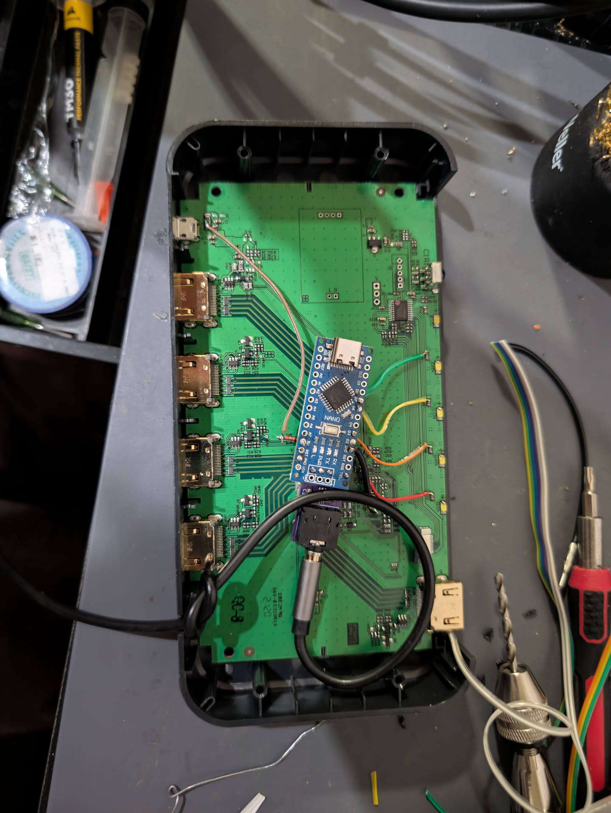
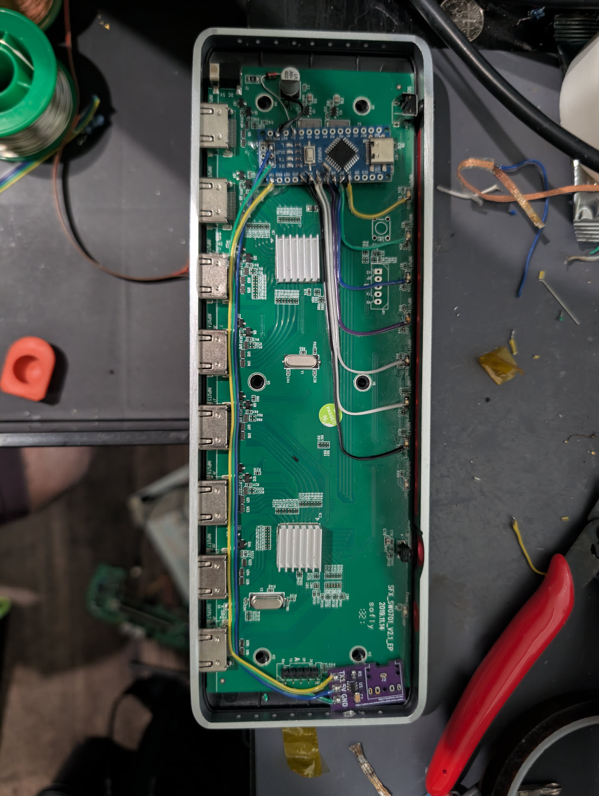
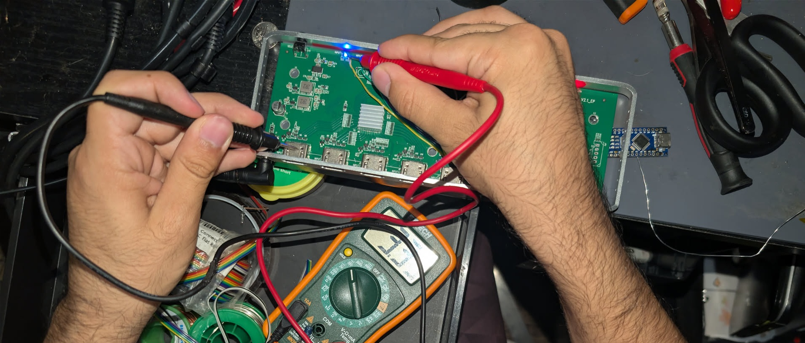
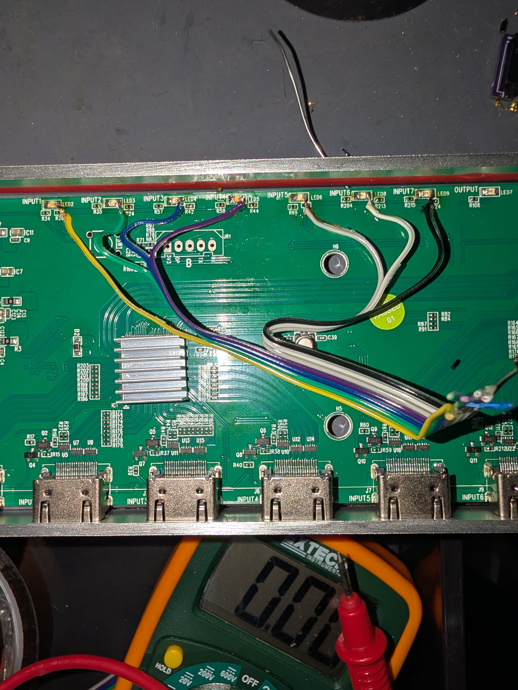
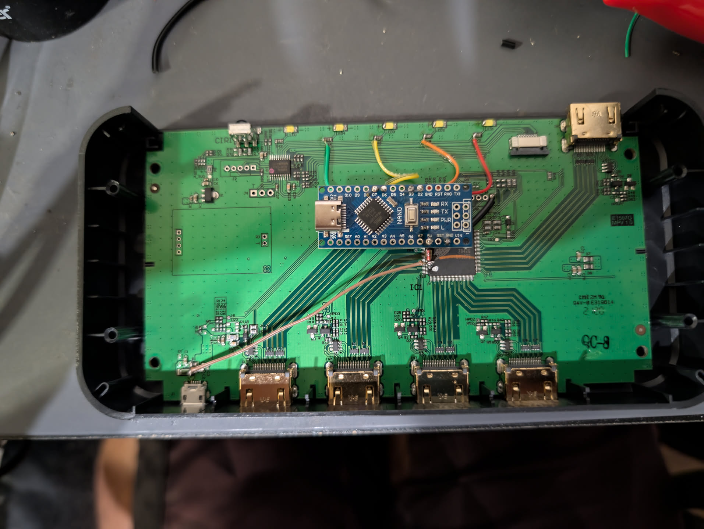
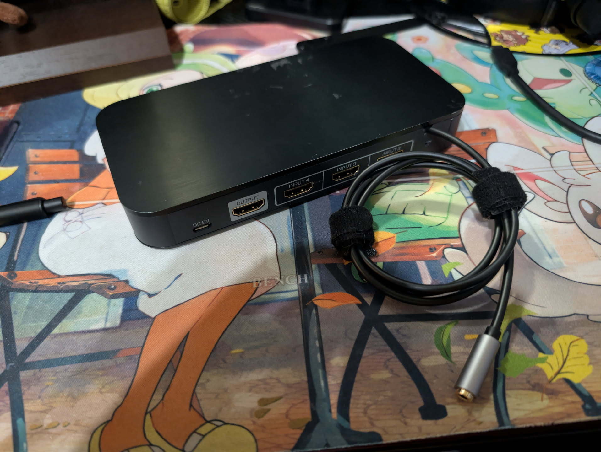

## Generic HDMI Switch 


RetroTink 4K HD15 Serial Control using an Arduino Nano, integrated with any generic HDMI switch. The code is very basic at the moment, but allows executing multiple commands to the RT4K (even with delays inbetween) if needed. Please feel free to fork / create PRs / etc. 

See it in action: https://youtu.be/L7HAki0e440

This implementation taps into the LEDs themselves. When an LED is lit, it naturally follows that the input is active. Each individual LED is connected to an input pin on the Arduino. If an input pin on the Arduino detects a HIGH signal (around 3.3V), then a command is sent to the RetroTINK telling it to change to the input assigned to that specific pin. This does not touch the HDMI signal or MCU and should not affect image quality. We do not have any specific documentation and the user assumes all risk for modifying their own devices. 

## Materials

- A soldering iron and a steady hand
- Wire. I used 28AWG stranded wire, but you can probably get away with any
- An Arduino Nano
- An assembled open drain board. You can find the .gerber [here](../PCB%20Files/rt4k_serial_otaku_pcb_gerber.zip). Please see the table below for more details.
- A M->F 3.5mm TRS cable
- A small hand drill
- BAT85 Diode (optional, but recommended)
- Hot air station (optional, but recommended)

**The following BOM is related to the open-drain board.**

| **Qty**    | Designation | Part |  Link  |
| ------------- | ------------- |------------- |-------------
| 1  | C1 | 0.1 uF / 100nF 50V X7R 0805 Capacitor| [Digikey](https://www.digikey.com/en/products/detail/yageo/CC0805KRX7R9BB104/302874?s=N4IgTCBcDaIMwEYEFokBYAMrkDkAiIAugL5A)
| 1  | R1 | 10K OHM 1% 1/8W 0805 Resistor | [Digikey](https://www.digikey.com/en/products/detail/yageo/AC0805FR-0710KL/2827834)
| 1  | U1 | IC BUF NON-INVERT 5.5V SOT23-6 | [Digikey](https://www.digikey.com/en/products/detail/texas-instruments/SN74LVC2G07DBVR/486427) or [alternate](https://www.digikey.com/en/products/detail/umw/SN74LVC2G07DBVR/24889644)
| 1  | PH1 | PJ-307 3.5mm Stereo Jack | [AliExpress](https://www.aliexpress.us/item/3256805624175150.html)


# Example

The following will be a demonstration of how this works with two of my HDMI switches. Please ignore the fact that one of them has actual built-in TX/RX.

## Step 0: Understanding the .ino file

The .ino has been changed for simplicity and uniformity with the HDMI .ino.
It **requires** pre-planning, as you need to know which switch input you want to take to the Nano.

This implementation sends a profile change when the input is HIGH. As such, line 70 MUST be:

`if (digitalRead(pin) == HIGH) {`. If you use the same .ino file as the SCART switch without changing this, this will not work.

In line 23 and 24, you will need to change the bounds of which you are setting up the Nano. For example, if you have a 10-input switch, you'll need 10 pins. For simplicity's sake, let's say those pins range from D2 to D11. Please reference this picture:



With this picture, D2 through D7 are used. So, the `pinLowerBound` value, or line 23, would be 2. The `pinUpperBound` value, or line 24, would be 7. Let's take a look at another example:



With this picture, D2 through D8 are used as this switch has 7 inputs. So, `pinLowerBound` would be 2, and `pinUpperBound` would be 8.

You will also need to modify the `switch` statement in line 80, depending on which GPIO pins you use for which input. Please reference the first picture once more. D2 is wired to Input 1, D3 is Input 2, D6 is Input 3, and D7 is Input 4.

As such, the `switch` statement for this board would be:

```
switch (currentActivePin) {

// This is user-defined. You can tie each case statement to a profile number.
        case 2: 
// For example, 2 here refers to Pin D2.
          profileNum = 1; 
// And profileNum here refers to what remote profile / SVS profile to send. Typically, this is going to be what switch input you're soldering to. You can add to this switch statement to fit your own needs.
          break; 
          
// Maybe you soldered Input 2 to Pin D2, which would mean you'd need to swap profileNum = 1 to profileNum = 2.

        case 3: // Pin D3
          profileNum = 2; // HDMI Input 2 
          break;
        case 6: // Pin D4
          profileNum = 3; // HDMI Input 3 
          break;
        case 7: // Pin D7
          profileNum = 4; // HDMI Input 4 
          break;
      }

// All these correspond to how the first picture is set up. This switch case statement will be different for the second picture.
```

You will need to modify this to fit however you solder. I encourage you to solder the wires to the board in Step 1, check how you're doing to lay it out / connect to the Nano, program the Nano, and then solder the Nano to the board.

There are two other parameters. If you choose to use SVS profiles rather than remote profiles (if you use the Donut Dongle you'll want remote profiles), you need to change line 26 to SVS = 1.
Additionally, if you have multiple devices, you'll want to set your offset in line 28 for SVS profiles. Whatever you choose to make this is up to you.

## Step 1: Planning
Take your switch apart. Some of them may require you to remove feet or adhesives to get to the screws. I recommend using a hot air station (you may be able to get away with a hair dryer in a pinch) to loosen the adhesive. Otherwise, you may damage the adhesive and getting it back to how it was prior to disassembly. This is a pretty important step, so be sure to take it seriously.

Once your switch is open, we need to locate a few things. The locations will vary per switch, but nearly always will be present:

- Space to put in your Arduino and open drain board. Something great here is that they don't necessarily have to be together and can be paired with wires.
- Any GND. Try to find one as close as where you want to place your Arduino, as GND should be as short as you can comfortably make it.
- Somewhere 5V is present. The switches pictured here are powered by 5V so this is decently simple. Be sure, however, to know what the voltage you're using to power the switch. If you're using a 12V barrel jack to power your switch, don't grab it from that area. You can power your switch and use a multimeter to find 5V.
- Your LEDs. With your multimeter, take a look at which leg has about 3.3V (which is the HIGH signal we want) when the LED is lit. Then, switch the input. If that leg is 0V (LOW) when it's no longer lit, that is the leg you should be soldering to. Note that in the picture, the multimeter displays 3.3V with the lit LED. I'm using one of the HDMI ports as a GND for the multimeter as it's the most convenient.



## Step 2: Soldering to the board
You'll need to solder a lead to your GND, your 5V, and each of your LEDs. If you're using a BAT85 diode, be sure to have the ring closer to the output side (towards where you'd put the Arduino), not the input side. This will make it so your switch powers the Arduino, but so that your Arduino does not power the switch in case you plug it into a computer.



What's best, right now, is to take a bit of a break and plan out what you're going to do. Where the wires will go to, without your iron touching the Arduino. In particular, you'll want to plan out where the LED cables will go to. These should be going to the digital pins in the Arduino. Plan out which pins you'll be using.
Once you're sure, you'll need to program your Arduino with the included .ino. Depending on your setup, you **will** need to change values in the .ino file as noted in Step 0.

## Step 3: Soldering to the Arduino
Once you've done this, solder them to the Arduino. Your 5V should go to 5V. Your GND should go to GND. Your LED pins should go to whichever digital pins (D) you planned out prior.



Finally, find somewhere to place your open-drain board and wire it to your Arduino. If you got the one from this repository, it should be labelled for you. TX1 goes to TX1. 5V goes to 5V. GND goes to GND. On one of these boards, I used wires. On the other, I soldered it directly into the Arduino using the through holes and headers.


## Step 4: Testing
Before anything else, test your work. You can do this a couple ways. The easiest is for you to plug in your Arduino to your computer, power your switch, and check the Serial Monitor as you swap the inputs. You should be seeing your commands send as you do. You can also test by plugging in the 3.5mm jack to a VGA serial breakout adapter to your RetroTINK, and checking if your commands work. Be sure to set up your SVS profiles or remote profiles for your tests to work.

## Step 5: Finalizing the output
Finally: we'll want to get the output, the female side of the TRS cable, outside of the switch. To do this, we'll use the drill. There is no real "rule" here. Just find somewhere convenient. What I prefer doing is to drill a small hole at the very top of the back. This creates a "U" shape where you can just place your cable. If you do this, be sure to tie a knot in the cable right before it reaches the U, as it acts as a strain relief. In case you pull on the cable, you won't run the risk of anything happening to it.

## Step 6: Pat yourself on the back
You're done! Close the shell, make sure the strain relief works well, and enjoy your auto-changing profiles

