## Otaku Games Line of Switches

RetroTink 4K HD15 Serial Control using an Arduino Nano, Integrated with Otaku Games Switches. This includes the SCART switches as well as the RGB RCA switches, which can be used for Component. The code is very basic at the moment, but allows executing multiple commands to the RT4K (even with delays inbetween) if needed. Please feel free to fork / create PRs / etc. 

See it in action: https://youtu.be/L7HAki0e440

This implementation taps into 2x ULN2003 Darlington Arrays that are used to activate a LED and relays for the LAST ACTIVE port. Each individual LED/relay line is connected to an input pin on the Arduino. If an input pin on the Arduino detects a voltage drop, then a command is sent to the RetroTINK telling it to change to that pin's / input port's assigned remote profile. This does not touch the signal or MCU and should not affect image quality. This is all based on my general observation of the PCB, I don't have any official documentation to go by.

This guide will include two methods: one which taps into alternative points connected to the Darlington Arrays or the "easy" method, and one which taps into the Darlingon Arrays themselves or the "hard" method.

## Materials

- A soldering iron and a steady hand
- Wire. I used 28AWG stranded wire, but you can probably get away with any
- An Arduino Nano
- An assembled open drain board. You can find the .gerber [here](https://github.com/svirant/RT4k_HD15_serial_control/blob/main/Otaku%20Games%20Scart%20Switch/rt4k_serial_otaku_pcb_gerber.zip). Please see the table below for more details.
- A M->F 3.5mm TRS cable
- BAT85 Diode (optional, but recommended)


**The following BOM is related to the open-drain board.**

| **Qty**    | Designation | Part |  Link  |
| ------------- | ------------- |------------- |-------------
| 1  | C1 | 0.1 uF / 100nF 50V X7R 0805 Capacitor| [Digikey](https://www.digikey.com/en/products/detail/yageo/CC0805KRX7R9BB104/302874?s=N4IgTCBcDaIMwEYEFokBYAMrkDkAiIAugL5A)
| 1  | R1 | 10K OHM 1% 1/8W 0805 Resistor | [Digikey](https://www.digikey.com/en/products/detail/yageo/AC0805FR-0710KL/2827834)
| 1  | U1 | IC BUF NON-INVERT 5.5V SOT23-6 | [Digikey](https://www.digikey.com/en/products/detail/texas-instruments/SN74LVC2G07DBVR/486427) or [alternate](https://www.digikey.com/en/products/detail/umw/SN74LVC2G07DBVR/24889644)
| 1  | PH1 | PJ-307 3.5mm Stereo Jack | [AliExpress](https://www.aliexpress.us/item/3256805624175150.html)

# Step 0: Understanding the .ino file

The .ino has been changed for simplicity and uniformity with the HDMI .ino.
It **requires** pre-planning, as you need to know which switch input you want to take to the Nano.

This implementation sends a profile change when the input is LOW. As such, line 66 MUST be:

`if (digitalRead(pin) == LOW) {`. If you use the same .ino file as the HDMI switch without changing this, this will not work.

In line 21 and 22, you will need to change the bounds of which you are setting up the Nano. For example, if you have a 10-input switch, you'll need 10 pins. For simplicity's sake, let's say those pins range from D2 to D11. Please reference this picture:

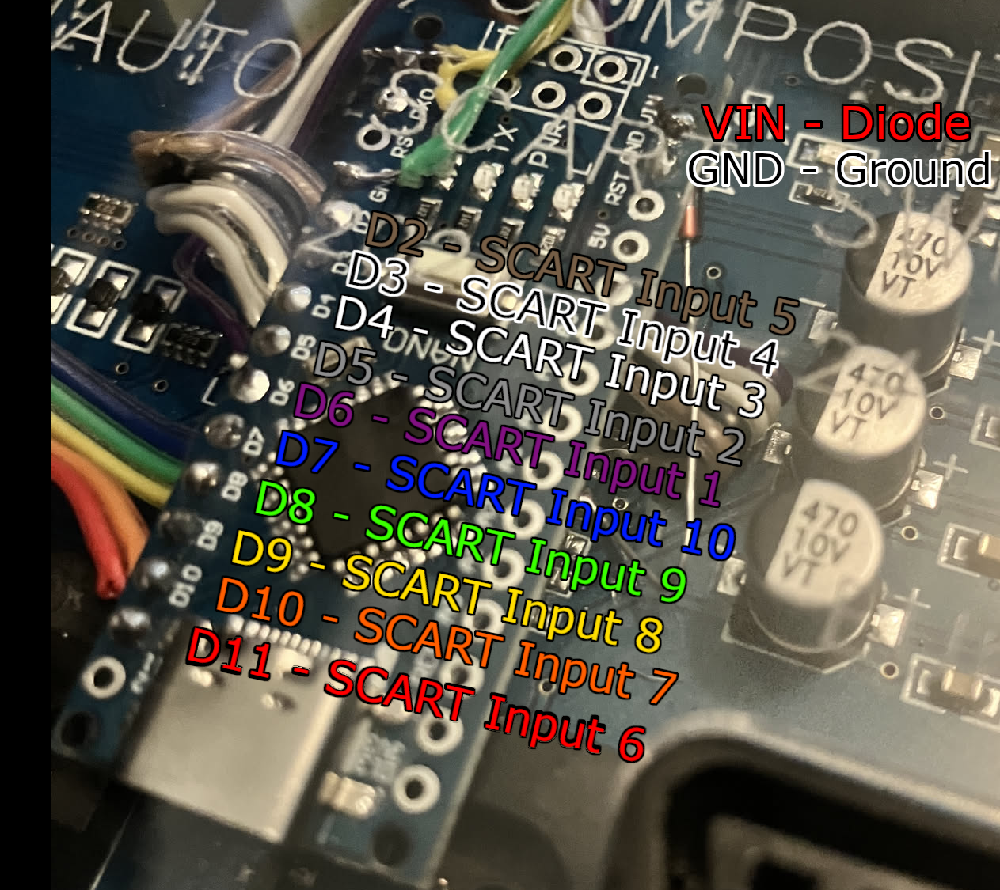

With this picture, D2 through D11 are used. So, the `pinLowerBound` value, or line 21, would be 2. The `pinUpperBound` value, or line 22, would be 11. Let's take a look at another example:

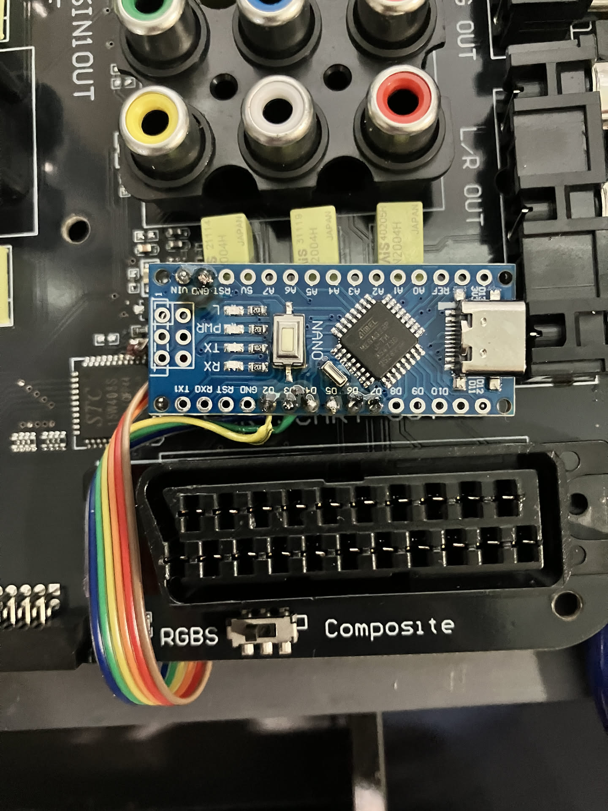

With this picture, D2 through D7 are used as this switch only has 6 inputs. So, `pinLowerBound` would be 2, and `pinUpperBound` would be 7.

You will also need to modify the `switch` statement in line 76, depending on which GPIO pins you use for which input. Please reference the first picture once more. D2 is wired to SCART Input 5, D3 is SCART Input 4, etc.

As such, the `switch` statement for this board would be:

```
switch (currentActivePin) {

// This is user-defined. You can tie each case statement to a profile number.
        case 2: 
// For example, 2 here refers to Pin D2.
          profileNum = 5; 
// And profileNum here refers to what remote profile / SVS profile to send. Typically, this is going to be what switch input you're soldering to. You can add to this switch statement to fit your own needs.
          break; 
          
// Maybe you soldered Input 2 to Pin D2, which would mean you'd need to swap profileNum = 5 to profileNum = 2.

        case 3: // Pin D3
          profileNum = 4; //SCART Input 4 
          break;
        case 4: // Pin D4
          profileNum = 3; //SCART Input 3 
          break;
        case 5: // Pin D5
          profileNum = 2; //SCART Input 2 
          break;
        case 6: // Pin D6
          profileNum = 1; //SCART Input 1 
          break;
        case 7: // Pin D7
          profileNum = 10; //SCART Input 10 
          break;
        case 8: // Pin D8
          profileNum = 9; //SCART Input 9 
          break;
        case 9: // Pin D9
          profileNum = 8; //SCART Input 8 
          break;
        case 10: // Pin D10
          profileNum = 7; //SCART Input 7
          break;
        case 11: // Pin D11
          profileNum = 6; //SCART Input 6
          break;
      }

// All these correspond to how the first picture is set up. This switch case statement will be different for the second picture.
```

You will need to modify this to fit however you solder. I encourage you to solder the wires to the board in Step 1, check how you're doing to lay it out / connect to the Nano, program the Nano, and then solder the Nano to the board.

## Step 1: Choose your method to get the switch state
### Option A: The "Easy" Method

These are alternate points in the backside of the board that are easier to solder to, in case you're not confident in soldering to the Darlington arrays. They appear to be universal to the design of the Otaku Games switches, but I can only speak from experience with the ones I've done. 

Soldering to these lets you skip both some tough soldering, as well as having to use a multimeter to check which leg in on the Darlington arrays corresponds to which input as those are not uniform between switches.

Note that the picture says "SCART Input 1", but this works with the Component switch as well.

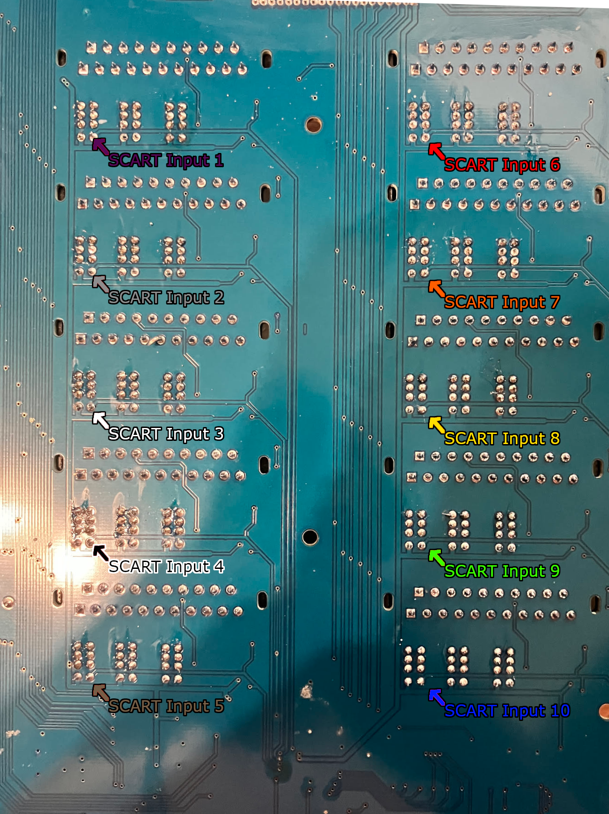

**Step 1:** Solder leads to each of the indicated points. The one pictured is a 6-port component switch.

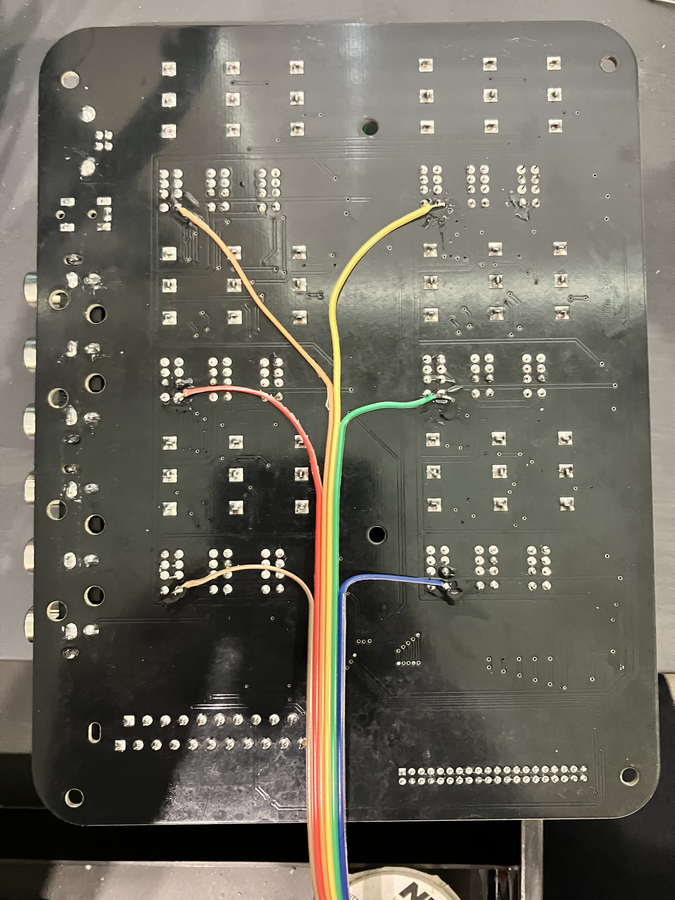

### Option B: The "Hard" Method

**Step 1**: We need to first determine which input corresponds to which pin in the Darlington array. To do this, we can just listen in with a multimeter by setting the one probe on a leg and cycling through inputs while your switch is turned on, as well as a second probe on any ground point. You may find that you have a negative voltage reading in your multimeter, but that's okay. It just means your probes are backwards. After probing, I found the following legs corresponded to the following inputs:

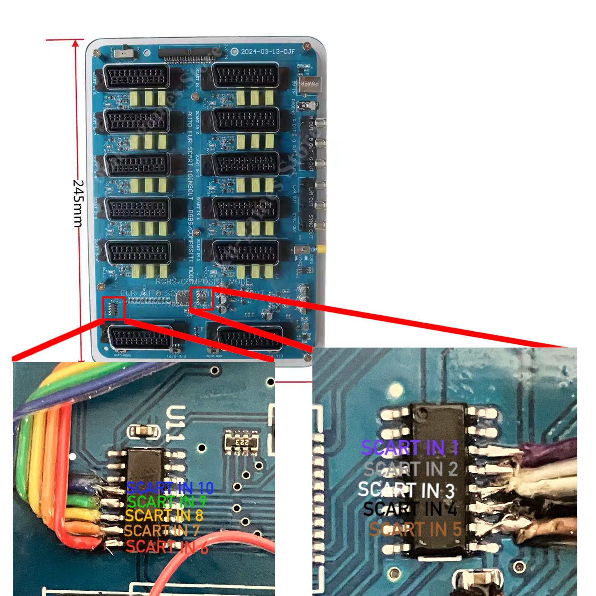


Solder leads to the pins. Once again, please check your own pinout before soldering. It's a lot easier to check with a multimeter than removing ribbon wires.

## Steps 2 and beyond:

From here, the steps for the "easy" and "hard" methods are the same.

**Step 2**: Solder to GND and 5V. We will need to power our Arduino Nano by tapping into the capacitor just below the Darlington Array for SCART inputs 1-5. Before soldering, please verify which is GND and which is 5V by using a multimeter in continuity mode. Strictly speaking, you don't need to use the same capacitor or source as this guide. If it is too challenging, you may also be interested in using the 5V and GND from the switch's USB port. It is recommended, however, to keep these leads as short as you can make them to minimize resistance in the leads. 

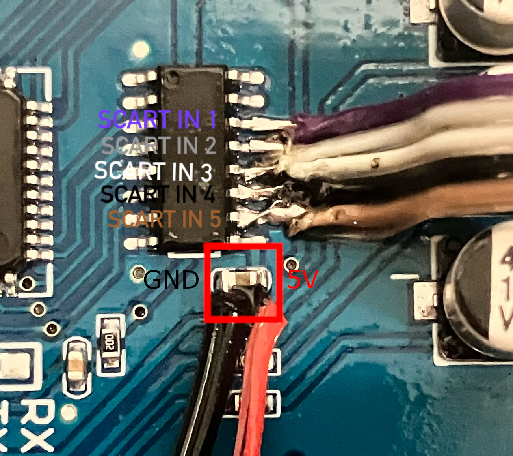

While the picture above has a red cable coming from the 5V point, I ended up replacing this cable for a BAT85 Schottky diode as to prevent backfeeding the switch when plugging in a USB-C cable from a PC to the Nano to program it. This might not be fully necessary, but I personally prefer to be a bit safer here. Be sure to orient the diode correctly, with the black ring side (cathode) closer to the Nano and the anode being soldered to the switch's capacitor. Additionally, ensure that the legs of the diode do not touch any other components. The picture below shows a diode.

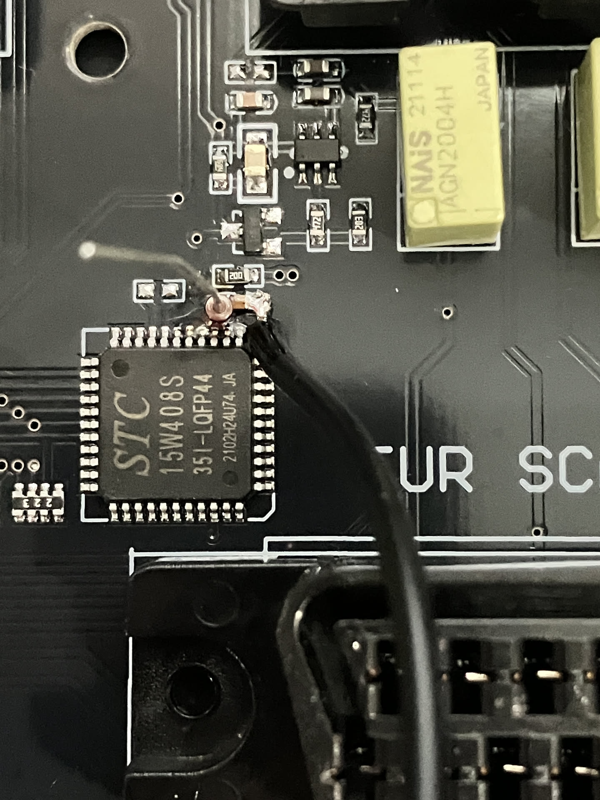

**Step 3**: Wire it all up to the Arduino Nano. The hard part of soldering to the board is over. Good work!
This is the pinout I followed when soldering the leads from the Darlington Arrays to the Arduino Nano:


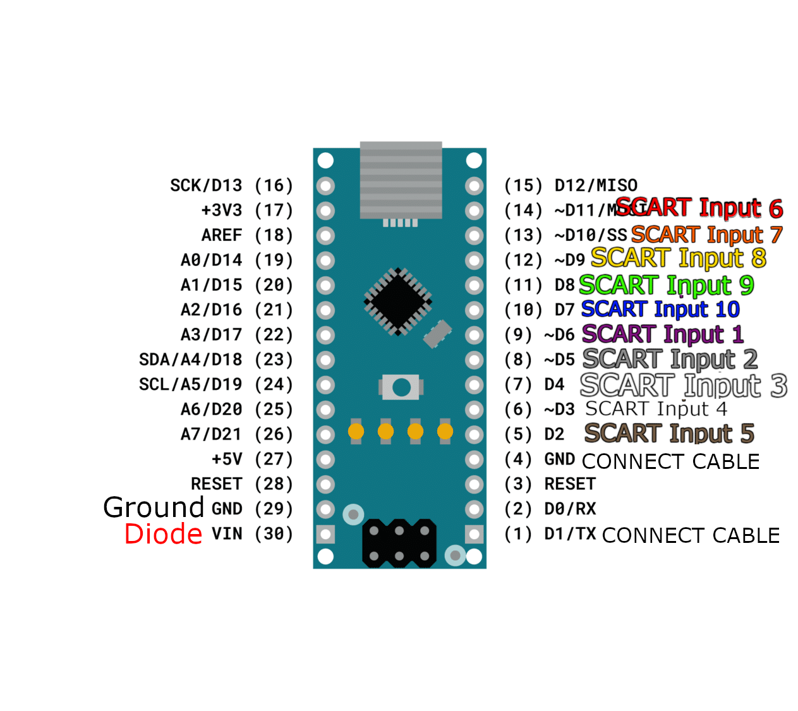


# Output Options

You have two options for outputting. Both will require either a VGA + Serial adapter for the RetroTINK or a Donut Dongle.

You can find the VGA adapter [here](https://ko-fi.com/s/0a49612856). Please note: if you are using this with a DonutDongle, you MUST use the `aux sw1` input, and you MUST set the Tx/Rx jumpers to L. 

If you wish to have those options sent for PCB manufacture instead, you can find the VGA + Serial adapter files [here](https://github.com/svirant/DonutDongle/blob/main/Adapters/VGAPassthrough_wSharedSerial.zip) and the DonutHole project [here](https://github.com/svirant/DonutHole). You can also use the DonutDongle, which has more features than the DonutHole. That project can be found [here](https://github.com/svirant/DonutDongle).

## Option A - Custom PCB

The Gerber Files (.zip) for a custom PCB are included in this project. It mounts directly to your Arduino Nano's through-holes for a very simple installation with no messy wires. You can upload the .zip to your favorite PCB manufacturer such as JLC (not sponsored) or PCBway (not sponsored) and assemble it yourself.

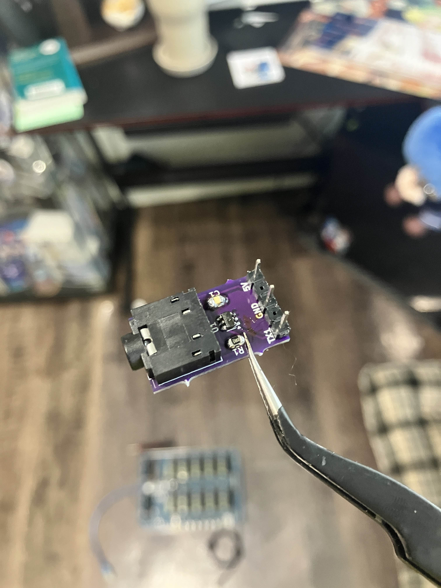

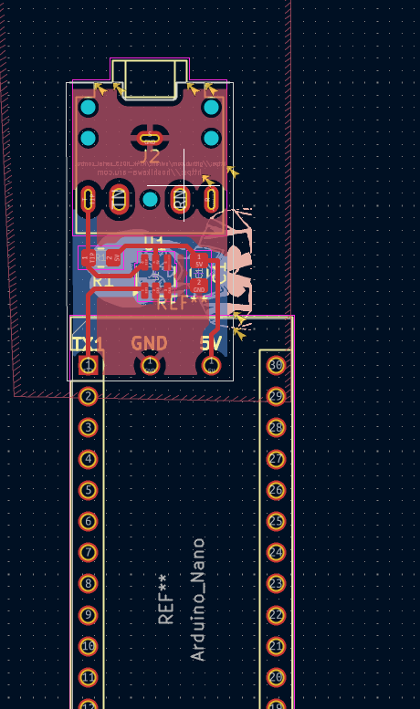

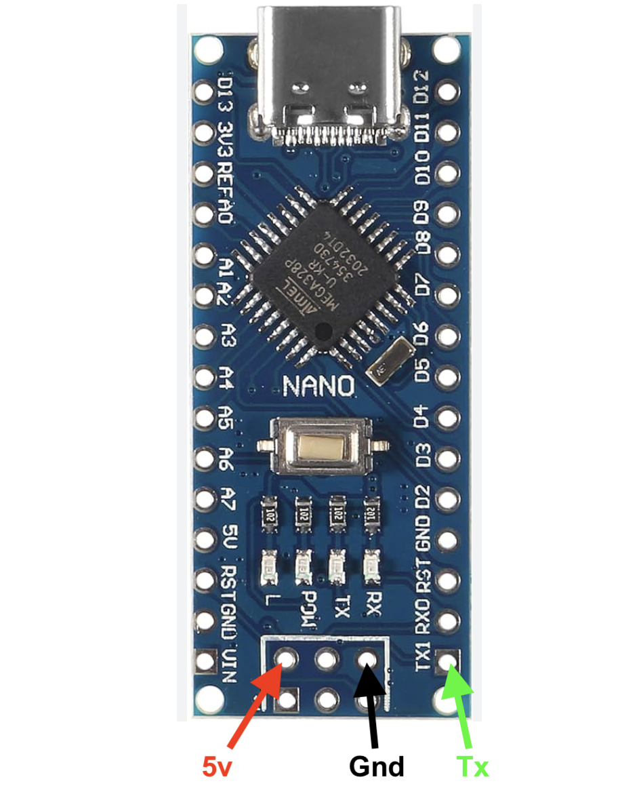

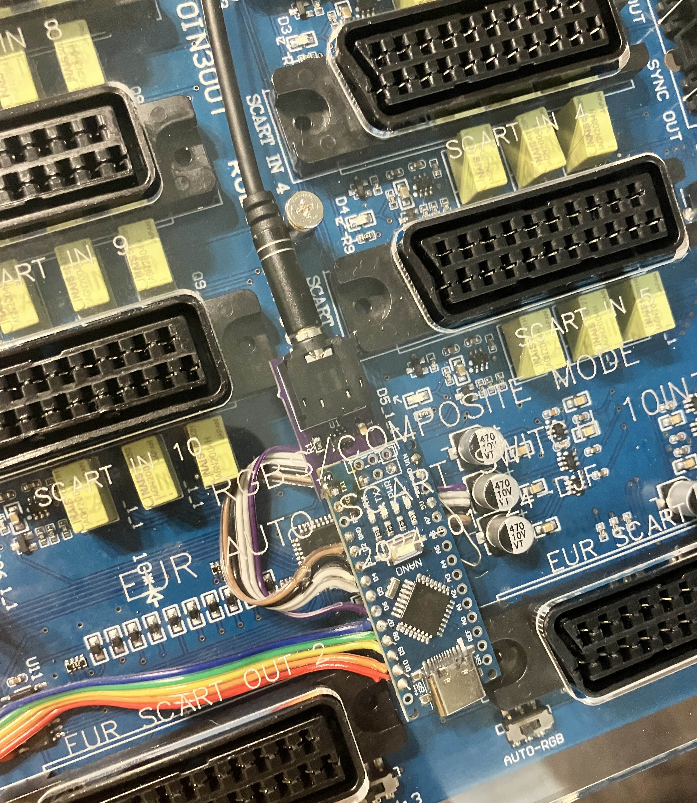
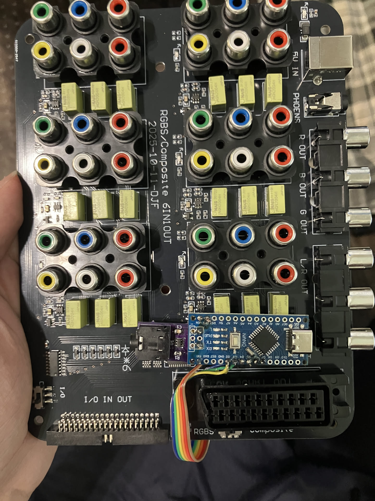

Plug in your M->F 3.5mm cable into the jack. Since your cable will be plugged into the Nano under the clear plastic, it is very recommended to route it and use some of the SCART ports and screw posts as stress relief.

You can see an installation video by clicking the image below:

[](https://www.youtube.com/watch?v=i_mYcqZmVAg)

## Option B - Breakout Board

An Amazon seller has a very convenient breakout board for SOT-23-6 packages: 

[Link (non-Affiliate)](https://www.amazon.com/dp/B09J2VG3BH?ref=ppx_yo2ov_dt_b_fed_asin_title&th=1)

A wiring diagram and install instructions would look as follows:

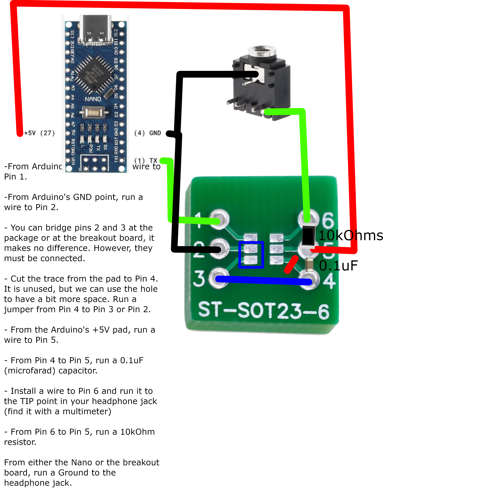

* From Arduino's TX1 point, run a wire to Pin 1.
* From Arduino's GND point, run a wire to Pin 2.
* You can bridge pins 2 and 3 at the package or at the breakout board, it makes no difference. However, they must be connected.
* Cut the trace from the pad to Pin 4. It is unused, but we can use the hole to have a bit more space. Run a jumper from Pin 4 to Pin 3 or Pin 2.
* From the Arduino's +5V point, run a wire to Pin 5.
* From Pin 4 to Pin 5, run a 0.1uF (microfarad) capacitor.
* Install a wire to Pin 6 and run it to the TIP (as in, Tip/Ring/Sleeve) point in your headphone jack (find it with a multimeter).
* From Pin 6 to Pin 5, run a 10kOhm resistor.
* From either the Nano or the breakout board, run a Ground wire to the headphone jack.


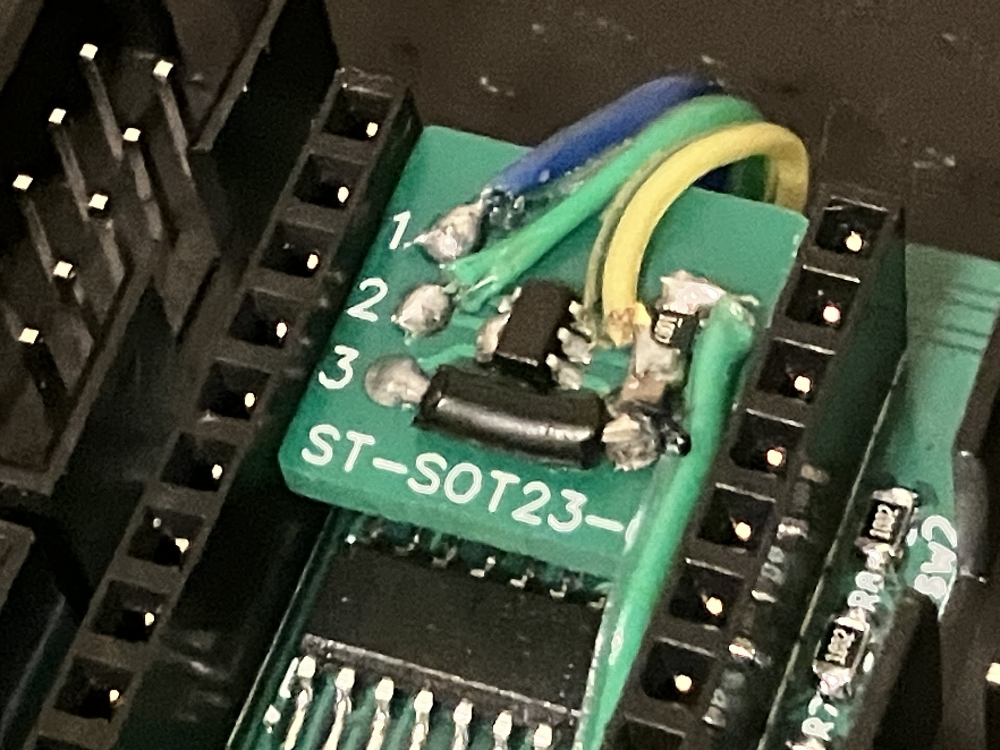

Please note that pictured is the full circuit. However, this particular picture is not from an Otaku SCART Switch, so placement will vary here.